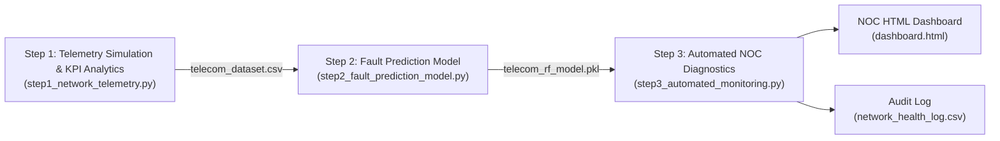

# Cellular Network Telemetry & Fault Anomaly Detection

An automated end-to-end telemetry analytics and machine learning pipeline for cellular network operations. The system simulates cellular radio access network (RAN) Key Performance Indicators (KPIs), aggregates tower-level health statistics, trains a Random Forest fault classification model to identify degraded cells, and serves an automated Network Operations Center (NOC) monitoring dashboard with persistent audit logging.

---

## Architectural Overview

The pipeline operates across three sequential operational layers:



---

## Telemetry Metrics and Physical Degradation Rules

The system analyzes four core radio access network KPIs across multi-cell cellular deployments:

* **Connected Users:** Active user equipment (UE) sessions (50 to 500 subscribers per sector).
* **Signal-to-Noise Ratio (SNR):** Physical channel quality measured in dB (\(\mu = 15.0\text{ dB}, \sigma = 5.0\text{ dB}\)).
* **Drop Call Rate (%):** Percentage of dropped calls per cell sector. Physics-based degradation doubles the drop rate whenever channel SNR drops below the 10.0 dB threshold.
* **Latency (ms):** Round-trip packet latency across the backhaul interface (20 ms to 150 ms).

---

## Pipeline Components

### Step 1: Telemetry Simulation & Field Maintenance Reporting (`step1_network_telemetry.py`)
* Synthesizes 1,000 hourly cellular telemetry records across distributed cell towers (`TOWER_001` to `TOWER_005`).
* Computes network-wide descriptive statistics and aggregates tower-level performance metrics.
* Generates comparative visual analytics:
  * Maximum Drop Call Rate across all cell towers (Seaborn Bar Chart).
  * Impact of Signal Quality (SNR) on Drop Call Rate with critical threshold markers (Seaborn Scatter Plot).
* Filters critical degradation events (`Drop_Call_Rate_Pct > 3.0%` or `SNR_dB < 10.0 dB`) and exports `critical_tower_report.csv`.
* Serializes the baseline dataset to `telecom_dataset.csv`.

### Step 2: Fault Classification Engine (`step2_fault_prediction_model.py`)
* Ingests `telecom_dataset.csv` and derives a binary ground-truth target (`Is_Critical`).
* Splits data into stratified training (80%) and testing (20%) partitions.
* Trains a `RandomForestClassifier` (100 estimators) on `Connected_Users`, `SNR_dB`, and `Latency_ms`.
* Outputs confusion matrix and classification report on unseen test data.
* Calculates feature importance coefficients to quantify which telemetry metric contributes most to network failure.
* Generates `feature_importance_plot.png` and serializes model weights to `telecom_rf_model.pkl`.

### Step 3: Automated NOC Diagnostics & Monitoring (`step3_automated_monitoring.py`)
* Ingests real-time streaming telemetry records.
* Executes inference via `telecom_rf_model.pkl` to evaluate operational health (`Normal` vs. `Critical`).
* Persists audit logs to `network_health_log.csv`.
* Automatically renders a styled dark-theme Network Operations Center (NOC) HTML Dashboard (`dashboard.html`).

---

## Directory Structure

```
telecom-network-anomaly-detection/
|-- step1_network_telemetry.py         # Telemetry generation and KPI reporting
|-- step2_fault_prediction_model.py    # Random Forest training and feature analysis
|-- step3_automated_monitoring.py      # Automated diagnostics and HTML dashboard
|-- telecom_dataset.csv                # Baseline cellular telemetry records
|-- critical_tower_report.csv          # Field maintenance incident report
|-- telecom_rf_model.pkl               # Serialized Random Forest model weights
|-- network_kpi_visualization.png      # Multi-panel KPI analysis chart
|-- feature_importance_plot.png        # Telemetry feature importance weights
|-- network_health_log.csv             # Operational diagnostic audit log
|-- dashboard.html                     # Rendered NOC monitoring dashboard
|-- requirements.txt                   # Python dependencies
|-- .gitignore                         # Standard exclusion rules
|-- LICENSE                            # MIT License
`-- README.md                          # Project documentation
```

---

## Installation & Environment Setup

1. Clone the repository:
```bash
git clone https://github.com/aydanaydemir/telecom-network-anomaly-detection.git
cd telecom-network-anomaly-detection
```

2. Initialize and activate a virtual environment:

**Linux / macOS:**
```bash
python3 -m venv venv
source venv/bin/activate
```

**Windows (PowerShell):**
```powershell
python -m venv venv
.\venv\Scripts\Activate.ps1
```

3. Install required packages:
```bash
pip install --upgrade pip
pip install -r requirements.txt
```

---

## Execution Guide

Execute the pipeline components sequentially:

### 1. Ingest Telemetry and Generate KPI Reports
```bash
python step1_network_telemetry.py
```
*Generates `telecom_dataset.csv`, `critical_tower_report.csv`, and `network_kpi_visualization.png`.*

### 2. Train Fault Classification Model
```bash
python step2_fault_prediction_model.py
```
*Evaluates model performance, saves `feature_importance_plot.png`, and serializes `telecom_rf_model.pkl`.*

### 3. Run Automated Diagnostics & Render Dashboard
```bash
python step3_automated_monitoring.py
```
*Appends health records to `network_health_log.csv` and renders `dashboard.html` for NOC operations.*

---

## Author

**Aydan Aydemir**
* GitHub: [@aydanaydemir](https://github.com/aydanaydemir)

---

## License

This project is licensed under the MIT License. See the [LICENSE](LICENSE) file for complete details.
